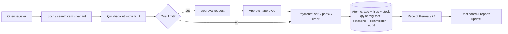
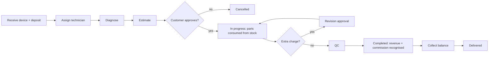
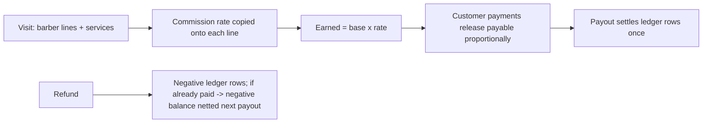
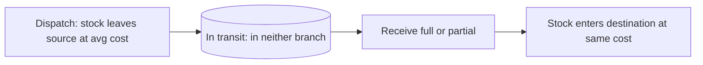
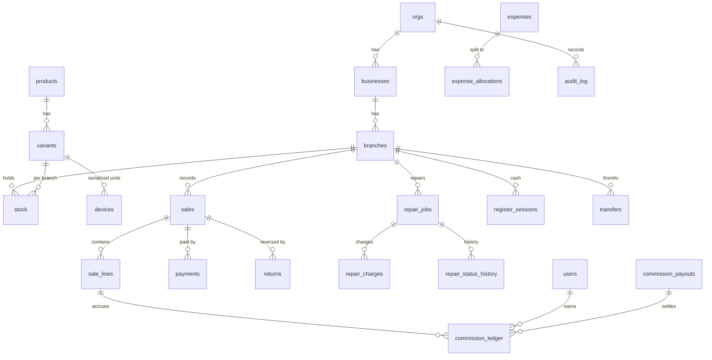

# Implementation proposal

> Status note: unlike a normal pre-development proposal, the platform described here **already exists in this repository** (built and tested). It is configured for **Hubdex Store LTD** with three branches – **Rio Berber** (barber/salon), **Rio Store** (clothing, shoes, fashion) and **Reyxaan Store** (electronics + repair). Where this proposal says *Done* it refers to working, tested code; *Not done* items are listed honestly in `LIMITATIONS.md`.

## 1. Understanding of the requirements
One system to run three kinds of business – clothing/footwear retail, electronics & mobile retail with device repair, and barber shops – across several businesses and branches, with **one owner dashboard** and **per-branch, per-role access that is enforced on the server**. Money must be correct and traceable: revenue, cash collected and profit are separate; inventory is costed (weighted average); barber/technician commission is computed per transaction, stored with the rate in force, paid once, and reversed on refunds; cash registers reconcile; nothing confirmed is edited or deleted – only voided, returned or reversed. The design must allow independent owners to be added later as tenants without re-architecting.

## 2. Recommended platform and why custom
**Custom build, Node.js 22 + SQLite, no runtime dependencies** (`ARCHITECTURE.md`).
Existing platforms were considered and **not used**:
| Option | Fit | Reason not chosen |
|---|---|---|
| UltimatePOS / similar PHP POS scripts | POS and stock yes | No per-barber commission ledger with proportional release and refund reversal, no serialized-device + repair workflow, limited multi-business branch RBAC; commercial licence per site; customisation means modifying vendor code, which complicates updates. |
| Odoo (Community/Enterprise) | broad ERP | Features such as POS, repairs and multi-company exist but the barber commission and branch-scoped permission model would be custom modules; Enterprise features are paid per user; upgrade of custom modules every major version. |
| ERPNext / Frappe | broad ERP, open source | Heavier operational footprint (Python/MariaDB/Redis stack); barber commission & repair job sheet need custom apps; per-branch access rules need careful configuration. |
(If you prefer one of these, verify the exact edition/version and licence then; I have not tied the recommendation to any particular version.)
Custom gives exact fit, no licence fees, tiny operational surface, and you own the code. The trade-off is that **you** (or your developer) maintain it: the code base is about 3,700 lines of dense application code plus 37 automated tests and 92 browser checks, deliberately small and dependency-free.

## 3. Modules (all Done unless stated)
Organisation/branches/departments · users/roles/permissions/approval limits · customers · suppliers · products & variants · devices (serial/IMEI, warranty, history) · purchases (partial receipt, landed cost, returns) · POS & sales · returns/exchanges/voids · quotations · transfers (in-transit) · stock counts/adjustments/movements · repairs (job sheet, statuses, estimates/revisions/approvals, parts, financials) · barber services/visits · commission ledger/payouts/advances · expenses & allocations · payments & reconciliation · cash registers & day closing · approvals · notifications · audit · dashboard · 17 reports · CSV/PDF/print · backups · platform/tenant console · EN/SO (Somali partial). *Not done:* e-mail/SMS/WhatsApp, payment-provider integration, SaaS billing, appointments, warehouses, xlsx.

## 4. Workflow diagrams





## 5. Database plan
55 tables (`migrations/001_init.sql`, `002_quotes.sql`). Every tenant table has `org_id`. Money = integer minor units.

Traceability: dashboard → `branchMetrics` SQL → rows in `sale_lines/returns/payments/commission_ledger/expense_allocations/repair_charges`; each KPI tile links to a list with the same filters, and the test-suite recomputes totals straight from those tables.

## 6. Interface wireframes (as built)
```
┌ Sidebar ──────┬ Top: org · 🔔 · EN/SO · ◐ · user ─────────────────────────────┐
│ Dashboard     │ [Business ▾][Branch ▾][Type ▾][Employee ▾][This month ▾]       │
│ SELL          │ ┌Net sales┐┌Repairs┐┌Collected┐┌COGS┐┌Gross profit┐             │
│  POS          │ ┌Commission┐┌OpEx┐┌Net profit┐┌Cash┐┌Mobile┐┌Bank┐┌Receivables…│
│  Barber visits│ [Trend line chart: net sales / collected / expenses]           │
│  Sales …      │ [Branch comparison bars] [Employee performance] [Approvals]    │
└───────────────┴────────────────────────────────────────────────────────────────┘
POS:  [Branch ▾  register status]            │ CART                         │
      [ scan / search ............ ][Search]  │  item  qty  price  disc  ✕   │
      ┌item┐┌item┐┌item┐ (tiles)             │  Subtotal / Discount / Total │
                                              │  Customer ▾  Payments +      │
                                              │  [      Complete sale     ]  │
Barber: [service tiles] → lines (barber ▾) → customer · tip · payments → [Record visit] · today's visits
Repair: header · status buttons → diagnosis · QC · charges table · customer decision · payments · photos · history · print
```
Responsive: sidebar collapses to a ☰ drawer below 900 px; tables scroll; POS stacks.

## 7. Milestones, effort and status
Each milestone ends with working, reviewable workflows (demo accounts in `README.md`).
| # | Milestone | Reviewable outcome | Est. hours | Status |
|---|---|---|---|---|
| M1 | Foundation & security | login/2FA, roles & limits, org/branch/staff, audit, branch isolation | 110 | Done |
| M2 | Inventory & retail | variants, purchases/PO, POS, returns/exchange, transfers, costing, counts | 230 | Done |
| M3 | Electronics & repair | IMEI sales/returns/warranty, job sheet, estimate→approval→parts→delivery | 170 | Done |
| M4 | Barber & commissions | visits, rates, ledger, payouts, advances, refunds | 130 | Done |
| M5 | Finance | expenses/allocations, registers, day close, payments/reconciliation, statements | 130 | Done |
| M6 | Dashboard, reports, printing | owner dashboard, 17 reports, CSV/PDF, thermal/A4 | 150 | Done |
| M7 | UX & notifications | responsive, dark mode, EN/SO (partial), approvals, alerts, quotations, uploads | 110 | Done (Somali needs review) |
| M8 | QA, hardening, docs | 37 tests, 92 browser checks, guides | 120 | Done except independent security test / load test |
| M9 | Deployment, UAT, training | live host, credentials hand-over, restore drill, video, staff training | 70 | **Not done** |
| | **Total** | | **1,220 h** | |

## 8. Timeline
A two-developer team would normally take ~14 weeks for M1–M9 (M1–M2 weeks 1–4, M3–M4 weeks 5–8, M5–M6 weeks 9–11, M7–M8 weeks 12–13, M9 week 14). **Remaining to go-live: about 2–3 weeks** – deployment (1–2 days), restore drill, UAT with real staff and fixes (≈ 1 week), Somali language review, training, and the recorded demo video.

## 9. Total price (indicative, USD 40/h assumption – see `COSTS.md`)
| | Hours | USD |
|---|---|---|
| Full scope as specified (M1–M9) | 1,220 | ≈ 48,800 |
| **Already built in this repository (M1–M8)** | 1,150 | ≈ 46,000 equivalent |
| **Remaining to production go-live** (M9 70 h + UAT fixes/contingency 80 h + Somali review 16 h + hand-over/training 24 h) | ≈ 190 | **≈ 7,600** + external security test (optional, USD 3–10 k) |
These are planning numbers, not a quotation; adjust to your rate and negotiate scope.

## 10. Recurring costs
≈ USD 10–25 / month hosting & backups (`COSTS.md` §2) + optional maintenance retainer + provider fees for any integration you add.

## 11. Paid modules / custom scope
**Required paid modules: none.** Custom development scope = the whole system (it is custom). Optional add-ons priced separately in `COSTS.md`: e-mail, SMS, WhatsApp, mobile-money, card, SaaS billing.

## 12. Support and maintenance terms (proposed)
* **Warranty:** 90 days from go-live – defects in agreed functionality fixed free.
* **Retainer (optional):** 8–16 h / month for fixes, small changes, Node/OS security updates, quarterly restore drill; ≈ USD 320–640 / month at the assumed rate.
* **Response targets:** critical (cannot trade / data risk) 4 business hours; major 1 business day; minor 3 business days.
* **Updates:** you own the code; updates are normal git releases with additive migrations; take a backup first (`BACKUP_RESTORE.md`).
