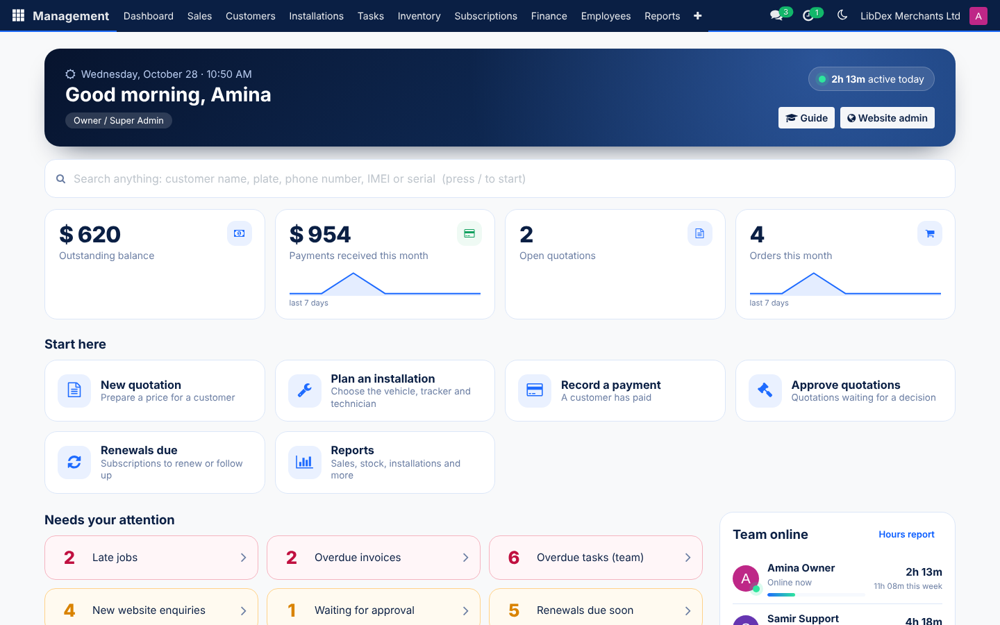
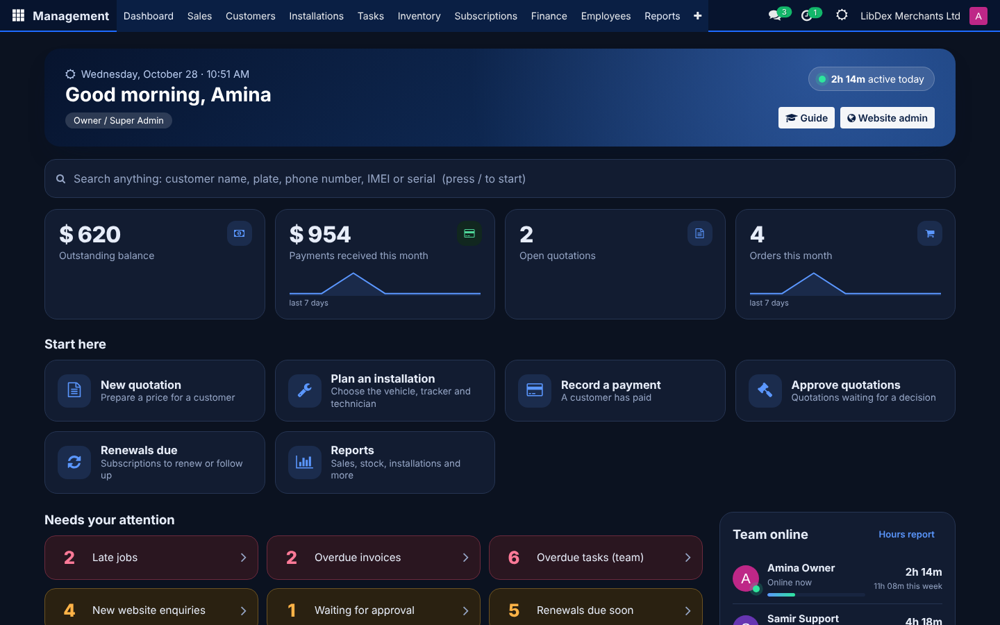
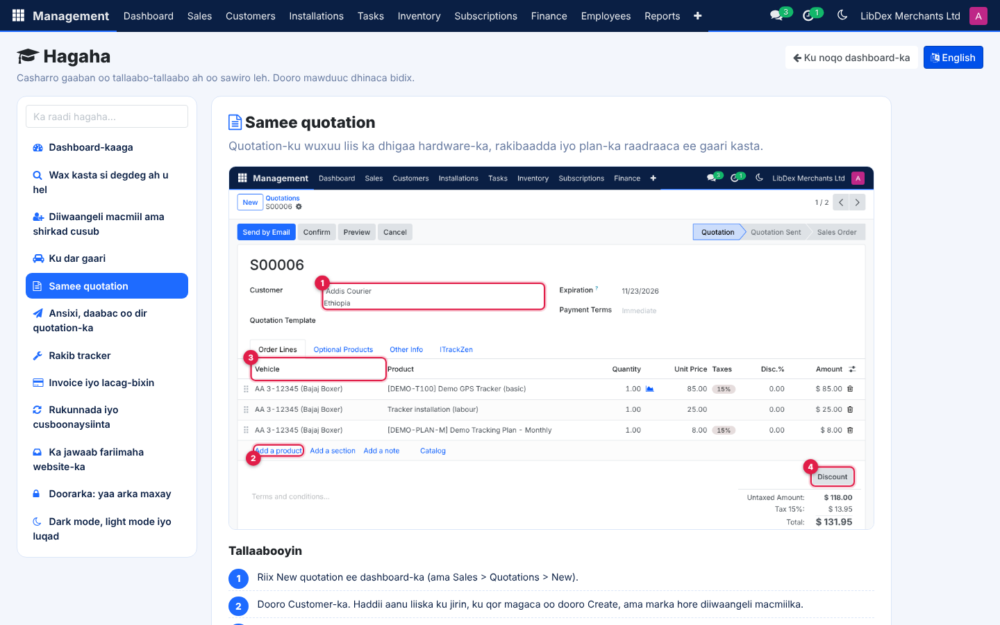

# User guide (short)

**Getting in.** Open `itrackzen.net/admin/`, press *Sign in with ITrackZen Management*, enter your own email and password (and your code if two-step verification is on).
You land on your home page. **Operations** opens the management system; **Website** (only if your role has it) has enquiries, deletion requests and content.
In the management system the top menu shows only what your role needs. **Website Admin** in the menu brings you back.

**The search box** on the Dashboard finds a customer, plate, phone number, IMEI, serial or SIM number in one go.

## The daily workflow (who does what)

1. **Storekeeper: receive hardware.** Inventory > Receipts and Transfers > New receipt from the supplier. For every tracker or dashcam type or scan its IMEI; for SIMs the ICCID.
   Duplicates are refused. Open the SIM later to add phone number, network and APN. Devices appear as *Available*.
2. **Sales Officer: quote.** Sales > Quotations > New. Customer, then lines: tracker, installation, tracking plan. Pick the **vehicle** on each line (add the vehicle from the customer if it is new).
   Add discount or taxes. Press *Send by Email* or *Preview* for the PDF.
3. **Approval.** If the quotation needs approval, press *Request approval*. An Operations Manager presses *Approve* (or *Reject* with a reason). Changing prices after approval clears the approval.
4. **Confirm.** *Confirm* creates the **installation jobs** (one per vehicle) and prepares the **subscriptions**.
5. **Operations Manager: schedule.** Installations > the job: choose the technician and date, add the IMEI and SIM per line, press *Schedule*. The technician gets a task.
6. **Storekeeper: issue equipment.** On the job press *Issue equipment to technician* (or Inventory > Issue / Return to Technician). The devices show *Issued to technician*.
7. **Technician: install.** Installations > My Jobs on a phone or tablet: *Start job*, add photos, the customer's name or signature under *Customer confirmation*, notes, then *Complete installation*.
   Stock moves to the customer, the device is linked to the vehicle, warranty and history are written, the subscription starts.
8. **Accountant / Cashier: invoice and payment.** Sales > the order > *Create Invoice* > confirm. Then *Register Payment* (full or part) with method and reference. Finance > Customer Statement prints or emails a statement.
9. **Renewals.** Subscriptions > Renewals Due. The system creates the renewal invoice before the date, emails the reminder, and marks the subscription *Expired* after the grace period. A payment re-activates it.
   Support can *Suspend* and *Resume*.
10. **Tasks.** Anyone can create tasks (installation, maintenance, support, sales follow-up, payment collection) with owner, deadline, priority, notes and attachments. Overdue invoices create **collection tasks** automatically.

## By role

| Role | Your home | Typical clicks |
|---|---|---|
| **Owner / Super Admin** | All figures, Reports, Configuration | Users and roles, settings, activity log (Configuration > Activity Log), website connection, tracking platform mode |
| **Operations Manager** | Team, approvals, jobs | Approve quotations, schedule jobs, stock adjustments, employees, reports, all tasks |
| **Sales Officer** | Enquiries, my quotations | New quotation, request approval, follow-up tasks |
| **Accountant / Cashier** | Invoices, payments, overdue | Create invoice, register payment, statements, overdue list, collections |
| **Storekeeper** | Stock, low stock | Receive, issue to technicians, return, mark damaged or warranty claim, SIM details |
| **Installation Technician** | My jobs, my equipment, my tasks | Start and complete jobs, photos, confirmation. You cannot see other jobs, customers or money |
| **Customer Support** | Customers, vehicles, subscriptions | Find by phone or plate, open the tracking platform page, suspend/resume, tasks |
| **Read-only** | Everything visible, nothing editable | Reports and lists |

## Reports

Management > Reports: choose the report, the period (or *This month*, *Last month*...), optional customer or technician, then **Print PDF** or **Export Excel**.
Available: stock availability, stock movements, installed devices, sales, payments received, outstanding invoices, overdue invoices, active subscriptions, upcoming renewals,
installations by technician, maintenance/removals/replacements by technician, employee tasks and completion. Reports with money are for Financial roles only.

## Good habits

* Scan or type the IMEI **exactly**; never reuse a device record for another physical unit.
* When a device is removed, use a **removal or replacement job**, not an edit on the vehicle, so the history stays complete.
* Do not share logins. Everything important is recorded under the signed-in person's name.

## Showing prices on the website (Finance and Store)

* **Tracking plans (Finance):** open the plan product (Inventory > Products and Stock), enter the **Sales Price**, tick **Show on the website** and choose the **Website plan card** (Starter, Business or Enterprise). The plan price appears on the Pricing page and the home page.
* **Hardware (Finance or Store):** open the tracker, dashcam or sensor, add its **photo**, **Brand** and **Model**, tick **Show on the website**, write one line under **Website description** and list what it does under **What it does** (one capability per line). The website shows the photo, model and capabilities with a **Request a quotation** button. **No price is published for hardware.**
* **Store:** receive the units as usual. The website shows **In stock** when units are available and **Out of stock, ask for lead time** when none are left. Customers never see quantities or costs.
* The website refreshes within 5 minutes. The Pricing page shows the plan prices and a hardware price table; the home page shows the plan cards.

## Replying to customers (Sales, Operations, Owner)

1. A message from the website arrives in **Sales > Website Enquiries**, with the customer's name, company, country, phone and email. The customer automatically receives an email from the no-reply address saying the message was received.
2. Open the enquiry and press **Reply by email**.
3. Under **What do you want to tell them?** write a few short notes in any language, choose the language of the reply, and press **Write it for me**. With AI switched on, a professional email is drafted; without it, your notes are placed in a simple template.
4. Read the text, change anything, and press **Send**. It goes out from the sales address with the ITrackZen by LibDex frame and your name, a copy is kept in the enquiry, and replies come to the sales mailbox.
5. The AI only knows what is in the customer message, your notes and the company facts the owner entered. It is told never to invent prices, dates or promises. **Always read it before sending.**

The owner switches AI on, enters the key and edits the company facts in **Settings > Companies > ITrackZen Management**. The customer's message and your notes are sent to the AI service to write the draft.

## Dashboard, hours online, dark mode and the Guide

* **Dashboard.** The page you land on. Big numbers at the top (click one to open the list), **Start here** buttons for your role, **Needs your attention** (red = late), what is coming up, and a search box (press `/`). It refreshes itself every minute.
* **Hours online (managers and owners).** The **Team online** panel shows who is online now and how long each person was active today and this week. The full list is in **Employees > Hours Online**. The hours are the time a person has the system open **and is using the mouse or keyboard**. A page left open and idle, or a closed page, adds nothing. This is *not* a timesheet or attendance record: someone working on the road with the page closed is not counted.
* **Dark mode / light mode.** Press the moon or sun button at the top right of any page. The choice is remembered on that computer and browser. Reports and PDFs always stay white.
* **Guide.** Press **Guide** on the dashboard (or open **Guide** in the menu). It has short lessons with pictures: the dashboard, searching, registering a new customer or company, adding a vehicle, making a quotation, approving and sending it, installing a tracker, invoices and payments, renewals, replying to website messages, roles, and dark mode. Press the language button at the top to read every lesson in **Somali** or **English**; the choice is remembered. The pictures show the system in English.

